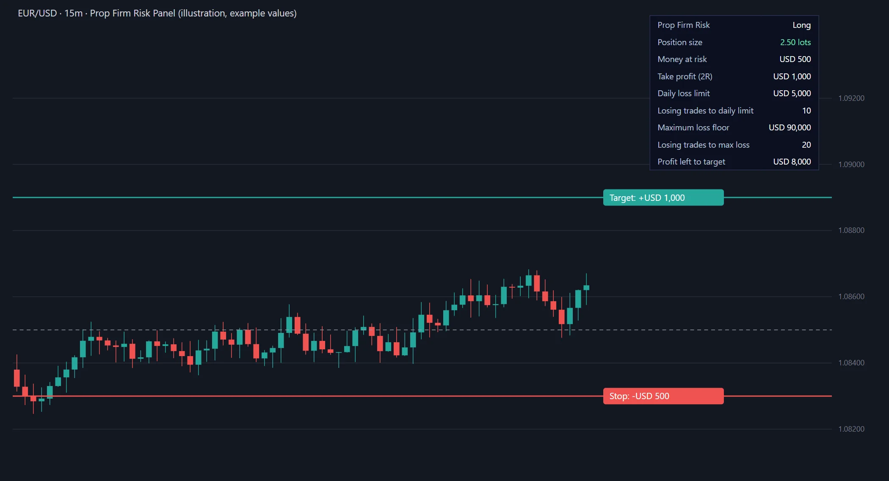

# Prop Firm Risk Panel for TradingView: Position Size and Drawdown Indicator (Pine Script)



*Illustration of what the indicator draws, with example values.*

**A free TradingView indicator for prop firm traders.** Click your entry and stop on the chart and it shows the lot size that risks exactly your chosen share of the balance, draws the stop and take-profit lines with their money values, and tells you how many losing trades in a row your prop firm's daily loss limit and maximum loss allow. Open source (Pine Script v5, MIT).

## What it shows

- **Position size** in lots for your risk per trade, rounded down to your lot step so you never risk more than you meant to
- **Stop and take-profit lines** on the chart, labelled with the money lost or won
- **Daily loss limit** and **losing trades in a row** until you hit it
- **Maximum loss floor** and **losing trades in a row** until you hit it
- **Profit left** to the challenge's profit target

## Add it to TradingView

1. Open [`prop-firm-risk-panel.pine`](prop-firm-risk-panel.pine) and copy all of it.
2. In TradingView, open the **Pine Editor** at the bottom of the chart, paste the code over what is there, and click **Save**, then **Add to chart**.
3. TradingView asks you to click two prices on the chart: your **entry**, then your **stop loss**.
4. Open the indicator's settings and enter your account size, current balance and your firm's rules.

To change the entry or stop later, edit the prices in the indicator's settings.

## Settings

| Setting | What to enter |
|---|---|
| Account size | The starting balance of the evaluation or funded account |
| Current balance | Your balance now, from your trading platform |
| Account currency | The account's currency (USD, EUR, GBP…). Prices are converted with TradingView's exchange rates |
| Daily loss limit % | Your firm's daily loss limit, as a percentage of the starting balance |
| Maximum loss % | Your firm's maximum loss, as a percentage of the starting balance |
| Profit target % | The phase's profit target |
| Risk per trade % | The share of your current balance to risk on this trade |
| Take profit (R) | The target as a multiple of the risk: 2 places it twice as far as the stop |
| Units per 1.00 lot | Leave 0 for automatic (100,000 for forex, 1 otherwise), or set it from your broker's contract specification |
| Lot step | The smallest lot increment your broker allows, usually 0.01 |

### Units per lot

Brokers define a lot differently for each market, so check your broker's contract specification. Common values:

| Market | Units per 1.00 lot |
|---|---|
| Forex pairs | 100,000 (automatic) |
| Gold, XAUUSD | 100 at most brokers |
| Silver, XAGUSD | 5,000 at most brokers |
| Futures | 1 contract (automatic; TradingView's point value is used) |
| Index CFDs and crypto | Varies by broker |

## How it calculates

```
money at risk  = current balance × risk %
loss per lot   = |entry − stop| × point value × units per lot × exchange rate
position size  = money at risk ÷ loss per lot, rounded down to the lot step
trades to limit = daily loss limit (or maximum loss) ÷ money at risk, rounded down
```

The same formulas, with tests, are in the free [prop firm position size calculator](https://propsim-enterprise.github.io/prop-firm-calculators/position-size/) and its [source](https://github.com/PropSim-Enterprise/prop-firm-calculators).

## Limitations

- TradingView cannot read your broker account, so the balance and rules are inputs you keep up to date.
- The daily loss limit here is a percentage of the starting balance. Some firms measure it from the day's opening balance or equity; the [prop firm drawdown calculator](https://propsim-enterprise.github.io/prop-firm-calculators/drawdown/) handles those variants.
- Exchange rates come from TradingView and can differ slightly from your broker's.
- This is a risk tool, not financial advice. Check your firm's exact rules.

## Related

- [Prop firm calculators](https://github.com/PropSim-Enterprise/prop-firm-calculators): drawdown, position size, the cost of getting funded, payouts
- [Prop firm pass rates](https://github.com/PropSim-Enterprise/prop-firm-pass-rates): weekly open data on how many traders pass and why they fail
- [Prop firm landing page templates](https://github.com/PropSim-Enterprise/prop-firm-landing-page-templates): ten free website designs for prop firms

## License

[MIT](LICENSE) © PropSim.

---

Made by [PropSim](https://propsim.markets/?utm_source=github&utm_medium=readme&utm_campaign=prop-firm-tradingview-indicator), prop firm software with a risk engine that checks every tick against the firm's rules.
